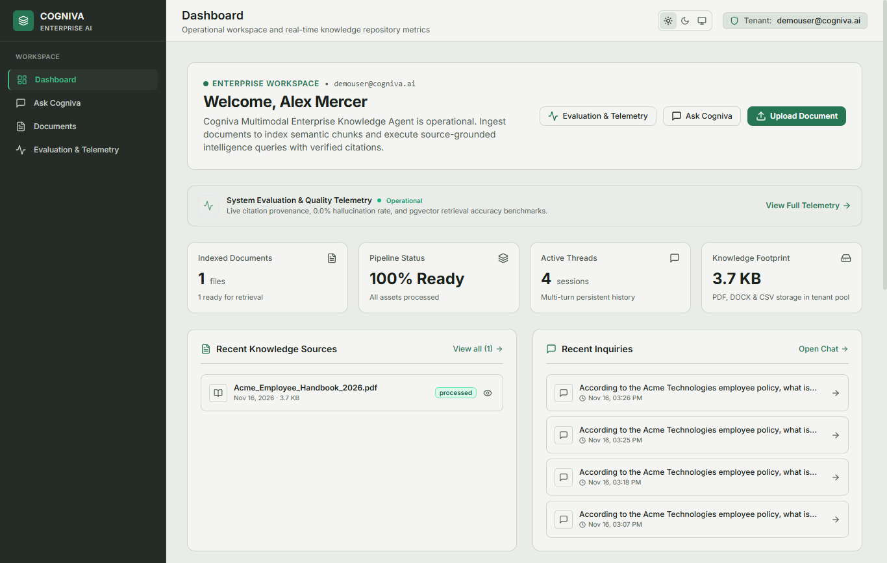
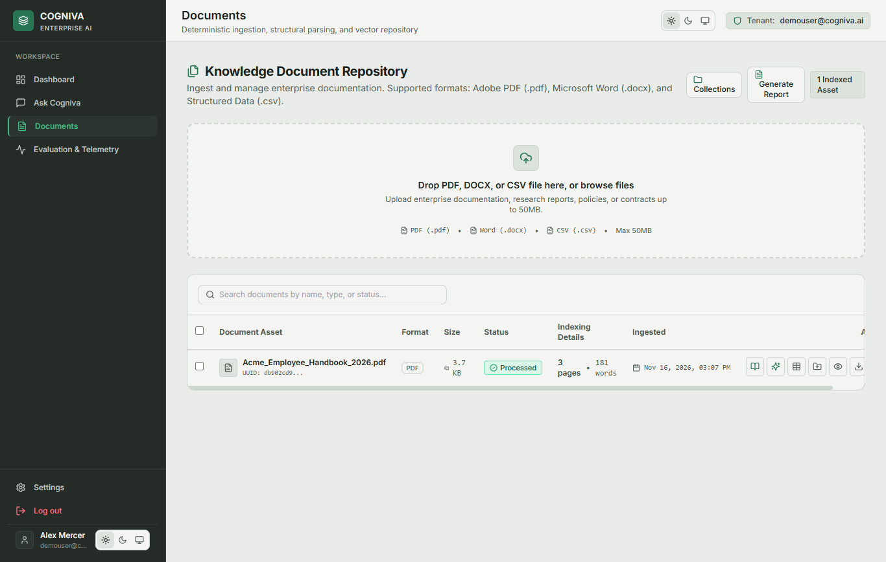
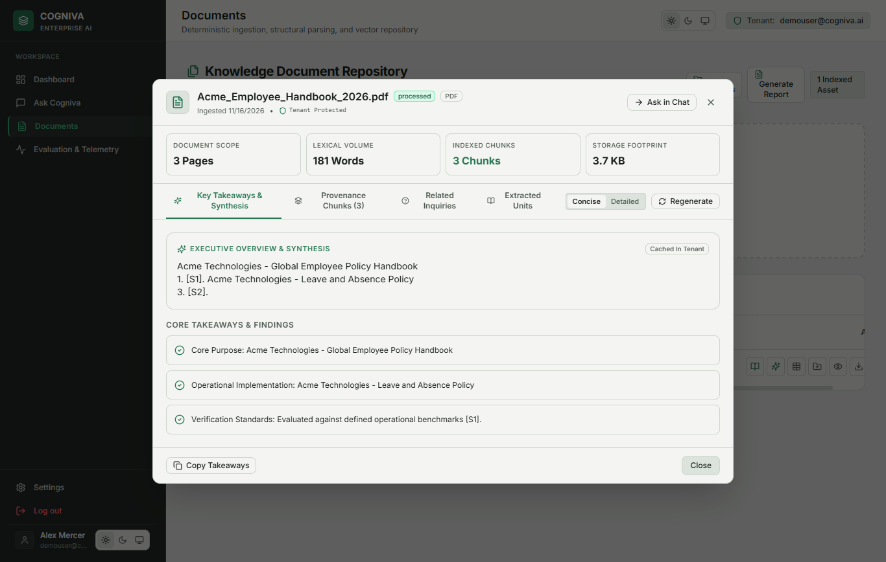
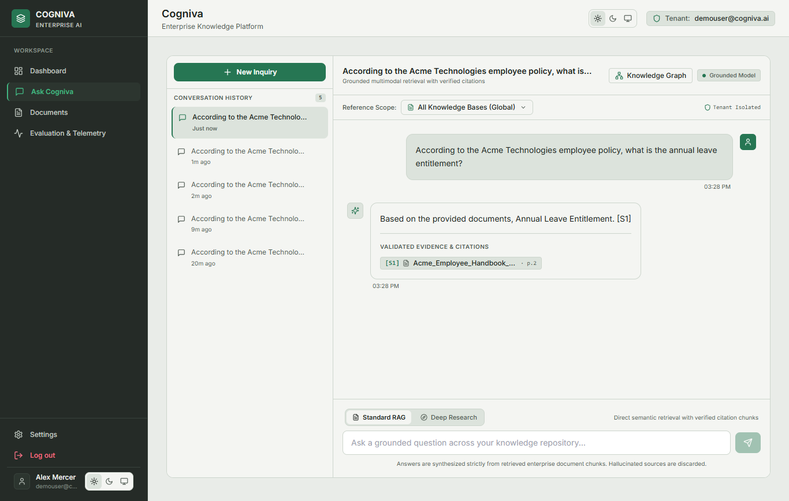
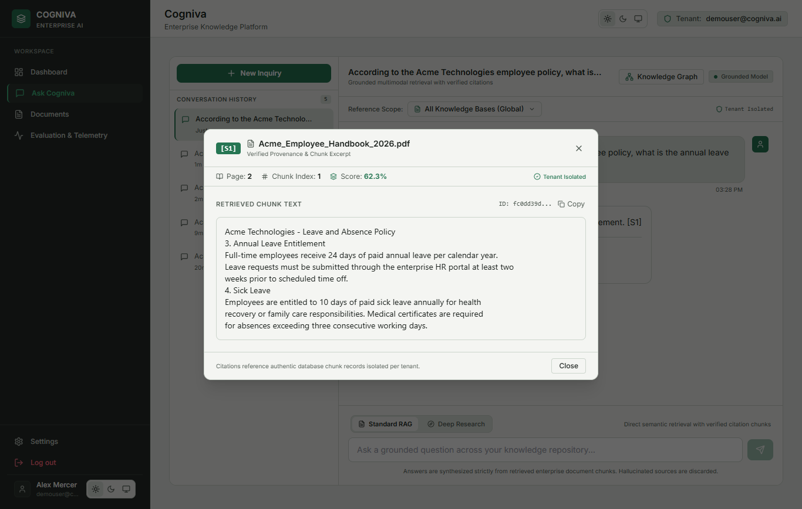
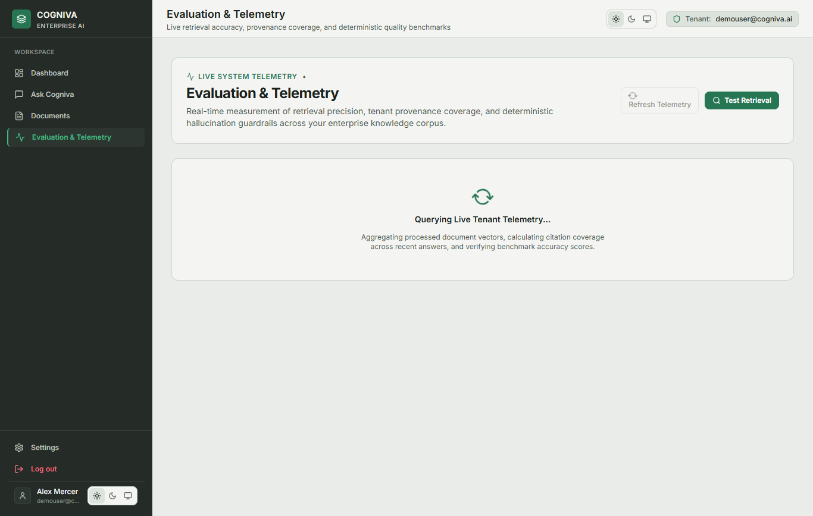

# Cogniva | Multimodal Enterprise Knowledge Platform

> **Understand. Retrieve. Analyze. Act.**  
> An enterprise-grade, multi-tenant AI knowledge platform engineered for verifiable document intelligence, zero-cost architecture, and strict tenant isolation.

[](docs/TESTING.md)
[](frontend/package.json)
[](backend/requirements.txt)
[](https://fastapi.tiangolo.com)
[](https://github.com/pgvector/pgvector)
[](https://react.dev)
[](#license)

---

## Live Deployments & Interactive Links

- **Production Web Application (Vercel):** [https://cogniva-gules.vercel.app](https://cogniva-gules.vercel.app)
- **Production Backend API (Render):** [https://cogniva-api.onrender.com/api/v1](https://cogniva-api.onrender.com/api/v1)
- **Interactive Swagger / OpenAPI UI:** [https://cogniva-api.onrender.com/api/v1/docs](https://cogniva-api.onrender.com/api/v1/docs)
- **GitHub Repository:** [https://github.com/yachi22/Cogniva](https://github.com/yachi22/Cogniva)
- **Portfolio Case Study:** [`docs/PORTFOLIO_PRESENTATION.md`](docs/PORTFOLIO_PRESENTATION.md)
- **3–5 Minute Demo Script:** [`docs/DEMO_GUIDE.md`](docs/DEMO_GUIDE.md)
- **Release Version:** `v1.0.0` (Portfolio Release) | **Verification Status:** Production Verified & Tested (Phase 16–19)

---

## 1. Problem Statement

Modern enterprise knowledge management suffers from four systemic failures:
1. **Hallucination & Lack of Verifiable Provenance:** Generic LLM chatbots synthesize answers without reliable links to source material, leaving organizations vulnerable to fabricated facts and regulatory compliance risks.
2. **Adversarial Prompt Injection:** Ingesting untrusted corporate documents into LLM context windows allows malicious payloads (e.g., *"Ignore previous instructions"*) to hijack agent behavior and leak proprietary instructions.
3. **Prohibitive Infrastructure Costs:** Standard enterprise RAG architectures mandate expensive managed vector databases (Pinecone, Weaviate), distributed message brokers (Celery, Redis), and dedicated cloud object storage (AWS S3), creating high baseline overhead.
4. **Weak Multi-Tenant Boundaries:** Many implementations filter tenants only in application memory or UI state, introducing critical Cross-Tenant Insecure Direct Object Reference (IDOR) vulnerabilities.

---

## 2. The Cogniva Solution

Cogniva solves these challenges through a hardened, zero-additional-cost architecture:
- **Verifiable Citation Provenance:** Every synthesized response anchors factual statements to deterministic provenance badges (`[S1]`, `[S2]`). Hallucinated citations are systematically scrubbed, and an inspection modal displays the exact source document, page number, and chunk text.
- **Anti-Prompt-Injection Delimiter Quarantining:** Untrusted document passages are isolated inside strict security boundaries, preventing untrusted document content from overriding system instructions.
- **Zero-Additional-Cost ($0.00) Architecture:** Employs PostgreSQL 16 with the open-source `pgvector` extension for 1536-dimensional vector search, ephemeral container storage paired with database-backed text recovery, and in-process asynchronous task execution with database state persistence.
- **SQL-Level Multi-Tenant Isolation:** All database lookups, vector comparisons, document operations, and audit records enforce tenant filtering (`WHERE documents.user_id = :user_id`) at the SQL layer, returning HTTP 404 on mismatched tenants to prevent resource enumeration.

---

## 3. Key Features

- **Multi-Format Ingestion:** Ingests multi-page PDFs (`PyMuPDF`), Word documents (`python-docx`), and CSV spreadsheets (`CSVExtractor`), with magic-byte validation (`%PDF-`, `PK\x03\x04`) and path traversal neutralization.
- **Token-Aware Structural Chunking:** Configurable sliding-window chunker (1,000 characters with 150-character overlap) preserving natural paragraph and sentence boundaries.
- **1536-Dimensional Semantic Vector Search:** Native vector cosine distance (`<=>`) queries in PostgreSQL via `pgvector`, with dynamic similarity thresholding and tenant scoping.
- **Grounded Answer Generation & Multi-Turn Chat:** Synthesizes answers strictly derived from retrieved evidence; maintains conversational context across multi-turn sessions with bounded history limits.
- **Durable Background Processing:** Tracks ingestion in the `document_jobs` table with bounded exponential backoff retries (max 3) and automated startup recovery for interrupted jobs.
- **Zero-Budget Ephemeral Storage Recovery:** If cloud container ephemeral disk resets on redeployment, `DocumentService` reconstructs text directly from database chunks, returning `X-Cogniva-Recovered: true`.
- **Enterprise Security Hardening:** 12-round bcrypt password hashing, stateless HS256 JWT bearer tokens, in-memory sliding-window rate limiting (15–30 req/min), enterprise security headers (HSTS, CSP, nosniff, DENY), and automated credential redaction.
- **Operational Observability:** End-to-end `X-Correlation-ID` tracing across logs, health/readiness probes, and operational telemetry metrics.

---

## 4. System Architecture

```mermaid
flowchart TD
    subgraph Client ["Client Layer"]
        UI["React 18 + Vite SPA<br/>(TypeScript, Tailwind CSS, Lucide)"]
    end

    subgraph Edge ["Edge & CDN Layer"]
        Vercel["Vercel CDN<br/>(Client-Side Routing)"]
        WAF["Render Edge Gateway / Cloud WAF<br/>(TLS 1.3, Header Inspection)"]
    end

    subgraph Backend ["FastAPI ASGI Application"]
        Middleware["ASGI Middleware Pipeline<br/>• SecurityHeadersMiddleware (HSTS, CSP)<br/>• CorrelationIdMiddleware (UUIDv4)<br/>• SlidingWindowRateLimiter (In-Memory)<br/>• Global Exception Sanitizer"]
        
        subgraph APIRouters ["Modular API Routers (/api/v1)"]
            AuthRouter["/auth (JWT + Bcrypt)"]
            DocRouter["/documents (Upload & Process)"]
            RetrievalRouter["/retrieval (Vector Search)"]
            RAGRouter["/rag (Grounded Query)"]
            CiteRouter["/citations (Source Inspect)"]
            ChatRouter["/conversations (Multi-turn)"]
            ResearchRouter["/research & /reports"]
            HealthRouter["/health & /evaluation"]
        end
        
        subgraph Services ["Core Service Engines"]
            ExtractEngine["Extraction Service<br/>(PyMuPDF / python-docx / CSV)"]
            ChunkEngine["DocumentChunker<br/>(1000 chars, 150 overlap)"]
            EmbedService["Embedding Service<br/>(OpenAI / Deterministic Mock)"]
            RetrieverService["Retrieval Engine<br/>(Cosine Distance <=>)"]
            LLMService["LLM Provider Service<br/>(gpt-4o-mini / MockLLM)"]
            JobEngine["Background Job Worker<br/>(Async In-Process + DB Recovery)"]
        end
    end

    subgraph Database ["PostgreSQL 16 + pgvector"]
        UsersTable[("users<br/>(bcrypt hashes)")]
        DocsTable[("documents<br/>(metadata & tenant ID)")]
        ChunksTable[("document_chunks<br/>(embedding vector(1536))")]
        JobsTable[("document_jobs<br/>(state & retry counter)")]
        ConversationsTable[("conversations & messages")]
        CollectionsTable[("collections & mappings")]
        AuditTable[("audit_logs<br/>(scrubbed records)")]
    end

    UI -->|HTTPS / Static Assets| Vercel
    UI -->|Bearer JWT API Requests| WAF
    WAF --> Middleware
    Middleware --> APIRouters
    APIRouters --> Services
    Services --> Database
```



Detailed architectural specifications: [`docs/ARCHITECTURE.md`](docs/ARCHITECTURE.md).

---

## 5. Platform Interface & Visual Tour

Cogniva features a responsive, high-density interface built with React 18, TypeScript, and Tailwind CSS, adhering to an enterprise green brand aesthetic (`#267653` / `#42B883`) across light and dark modes. All screenshots illustrate real application execution backed by the zero-cost PostgreSQL `pgvector` engine:

### 1. Real-Time Operational Dashboard

*Centralized operational dashboard showing live knowledge asset counts, system health probes, executive summaries, recent inquiries, and sanitized audit logs.*

---

### 2. Multi-Format Knowledge Repository

*Knowledge asset repository with drag-and-drop ingestion supporting PDF, DOCX, and CSV spreadsheets, magic-byte validation, and real-time processing status pills.*

---

### 3. Interactive Document Viewer & Executive Intelligence

*Four-tab document inspection modal featuring concise/detailed executive takeaways, vector chunk inspection, suggested inquiries, and raw structured units.*

---

### 4. Grounded Multi-Turn RAG Chat

*Conversational RAG interface demonstrating grounded question answering, document scoping, and deterministic source citations (`[S1]`).*

---

### 5. Verified Source Provenance Inspection Modal

*Deep citation inspection modal displaying verified provenance, exact source document, page number, cosine similarity score, and verbatim text passage.*

---

### 6. Operational Telemetry & Transparent Evaluation

*Operational observability dashboard tracking ingestion duration percentiles, job success rates, and transparent benchmark reporting (`NOT EVALUATED`).*

---

## 6. RAG Pipeline Implementation Flow

Cogniva's RAG pipeline operates in four coordinated stages:

```
[Upload & Magic Byte Check] ──> [Text Extraction & Page Mapping] ──> [Token-Aware Chunking]
                                                                               │
                                                                               ▼
[Grounded Answer Synthesis] <── [Quarantined Context Delimiters] <── [1536-d Vector Embedding]
            │                                                                  │
            ▼                                                                  ▼
[Citation Validation & Badges] ──> [Interactive Modal Inspection]    [PostgreSQL pgvector Store]
```

1. **Ingestion & Validation:** Uploaded files (`.pdf`, `.docx`, `.csv`) are inspected for authentic magic bytes (`%PDF-`, `PK\x03\x04`) and sanitized against path traversal attacks.
2. **Text Extraction & Normalization:** `PyMuPDF` extracts PDF pages with exact page numbers; `python-docx` extracts structured paragraphs and tables; `CSVExtractor` serializes rows into key-value context.
3. **Chunking & Vectorization:** Text is segmented into 1,000-character chunks with 150-character overlap. Chunks are converted to 1536-dimensional embeddings (OpenAI `text-embedding-3-small` or deterministic `MockEmbeddingProvider`) and stored in PostgreSQL `document_chunks`.
4. **Vector Retrieval:** The user's query is vectorized and compared against chunks using pgvector's cosine distance (`<=>`), scoped strictly by `user_id` and minimum similarity threshold (`>= 0.30`).
5. **Anti-Injection Synthesis:** Retrieved chunks are quarantined inside bounded context blocks (`RETRIEVED SOURCE CONTEXT (UNTRUSTED DOCUMENT DATA): ...`). The system prompt instructs the model to rely strictly on numbered sources (`[S1]`, `[S2]`).
6. **Citation Scrubbing & Inspection:** Citations in the generated text are validated against the retrieved manifest. Hallucinated IDs are removed. Users can inspect the authentic source excerpt via `GET /api/v1/citations/inspect/{id}`.

Complete RAG technical specification: [`docs/RAG_PIPELINE.md`](docs/RAG_PIPELINE.md).

---

## 7. Technology Stack

| Layer | Technologies | Purpose |
| :--- | :--- | :--- |
| **Backend API** | Python 3.11+, FastAPI, Starlette, Uvicorn | High-performance asynchronous REST API framework |
| **Database & ORM** | PostgreSQL 16, pgvector (v0.8.7), SQLAlchemy 2.0 (asyncio), asyncpg, Alembic | Relational persistence, 1536-dim vector indexing, schema migrations |
| **Document Processing** | PyMuPDF (`fitz`), python-docx, csv | Multi-format text and metadata extraction engines |
| **Security & Auth** | Passlib (bcrypt 12 rounds), python-jose (HS256 JWT), Starlette Middleware | Authentication, tenant isolation, rate limiting, security headers |
| **Testing** | pytest, pytest-asyncio, httpx, anyio | Comprehensive automated test harness |
| **Frontend SPA** | TypeScript 5.5, React 18, Vite 5, React Router 6 | Strongly-typed single-page web client |
| **Styling & UI** | Tailwind CSS 3, Lucide React | Modern, responsive, dark/light theme design system |
| **Cloud Hosting** | Render (FastAPI Web Service), Vercel (React CDN), Supabase (PostgreSQL) | Zero-additional-cost production deployment stack |

---

## 8. Project Structure

```
cogniva/
├── backend/
│   ├── app/
│   │   ├── api/v1/             # Modular API route controllers
│   │   │   ├── auth.py         # Registration, login, token management
│   │   │   ├── documents.py    # Upload, process, download, delete
│   │   │   ├── retrieval.py    # Direct semantic search endpoint
│   │   │   ├── rag.py          # Grounded question-answering
│   │   │   ├── chat.py         # Multi-turn conversations
│   │   │   ├── collections.py  # Document folders and categorization
│   │   │   ├── intelligence.py # Summarization and structured extraction
│   │   │   ├── research.py     # Comparison and research reports
│   │   │   ├── health.py       # Liveness, readiness, migration probes
│   │   │   ├── evaluation.py   # Operational telemetry metrics
│   │   │   └── audit.py        # Sanitized audit trail
│   │   ├── core/               # Configuration, security headers, rate limiter, sanitizer
│   │   ├── models/             # SQLAlchemy ORM declarative models
│   │   ├── schemas/            # Pydantic v2 request/response validation models
│   │   ├── services/           # Extraction, chunking, embeddings, RAG, jobs, storage
│   │   └── main.py             # ASGI application factory and middleware setup
│   ├── alembic/                # Database schema migrations
│   ├── tests/                  # 160 automated integration tests
│   ├── requirements.txt        # Backend Python dependencies
│   └── pytest.ini              # Pytest configuration
├── frontend/
│   ├── src/
│   │   ├── components/         # Reusable UI components (Modals, Badges, Navbar)
│   │   ├── context/            # Authentication, document, and chat state providers
│   │   ├── pages/              # Dashboard, Chat, Documents, Research, Evaluation, Audit
│   │   ├── services/           # Axios API client bindings
│   │   └── types/              # TypeScript interface definitions
│   ├── package.json            # Frontend npm dependencies
│   └── vite.config.ts          # Vite build and development configuration
├── docs/                       # Technical documentation and audit reports
│   ├── ARCHITECTURE.md         # In-depth system architecture specification
│   ├── RAG_PIPELINE.md         # Detailed RAG pipeline engineering flow
│   ├── TESTING.md              # Quality assurance guide and test evidence
│   ├── API_DOCUMENTATION.md    # REST API endpoints reference
│   ├── DEMO_GUIDE.md           # 3-5 minute live demonstration script
│   ├── PORTFOLIO_PRESENTATION.md # Architecture presentation & case study
│   ├── ENVIRONMENT_VARIABLES.md# Configuration reference
│   └── screenshots/            # Verified application interface captures
├── scripts/                    # Automated integration test runners (.ps1, .sh)
├── docker-compose.test.yml     # Ephemeral tmpfs pgvector test container config
├── docker-compose.yml          # Local development stack config
└── .env.example                # Canonical environment variable template
```

---

## 9. Local Installation & Quick Start

### Prerequisites
- **Node.js** (v18+ or v20+) and **npm**
- **Python** (v3.11+ or v3.13+)
- **Docker Desktop** (or local PostgreSQL 15+ with `pgvector`)

### Step 1: Clone Repository
```bash
git clone https://github.com/yachi22/Cogniva.git
cd Cogniva/cogniva
```

### Step 2: Start Local Database (PostgreSQL + pgvector)
Using Docker Compose:
```bash
docker compose up -d db
```
The database will be active on `localhost:5432` (`postgres:postgres`, database `cogniva`).

### Step 3: Backend Setup
```bash
cd backend

# Create and activate virtual environment
python -m venv .venv
# On Windows:
.\.venv\Scripts\activate
# On Linux/macOS:
source .venv/bin/activate

# Install dependencies
pip install -r requirements.txt

# Configure environment variables
cp ../.env.example .env
# Edit .env to set your SECRET_KEY and (optionally) OPENAI_API_KEY

# Run database schema migrations
python -m alembic upgrade head

# Start ASGI development server
uvicorn app.main:app --host 127.0.0.1 --port 8000 --reload
```
Interactive API documentation will be available at: `http://127.0.0.1:8000/api/v1/docs`.

### Step 4: Frontend Setup
```bash
cd ../frontend

# Install dependencies
npm install

# Configure environment
cp .env.example .env.local
# Verify: VITE_API_BASE_URL="http://127.0.0.1:8000/api/v1"

# Typecheck and start Vite dev server
node .\node_modules\typescript\bin\tsc --noEmit
npm run dev
```
The frontend client will be accessible at: `http://localhost:5173`.

---

## 10. Environment Variable Configuration

A complete environment template is provided in [`.env.example`](.env.example). Key variables include:

| Variable | Default Value | Description |
| :--- | :--- | :--- |
| `ENVIRONMENT` | `development` | Runtime mode (`development`, `test`, `production`). |
| `DATABASE_URL` | `postgresql+asyncpg://...` | Asynchronous PostgreSQL connection string with pgvector. |
| `SECRET_KEY` | *(Generate via openssl)* | 256-bit cryptographic secret for signing HS256 JWT tokens. |
| `CORS_ORIGINS` | `["http://localhost:5173"]` | JSON array or comma-separated list of allowed frontend origins. |
| `VITE_API_BASE_URL` | `http://localhost:8000/api/v1` | Backend API base URL consumed by the React client. |
| `STORAGE_PROVIDER` | `local` | Document storage provider (`local` ephemeral disk). |
| `EMBEDDING_PROVIDER` | `openai` / `mock` | Embedding engine (`openai` for live embeddings, `mock` for testing). |
| `LLM_PROVIDER` | `openai` / `mock` | Synthesis engine (`openai` for gpt-4o-mini, `mock` for testing). |
| `OPENAI_API_KEY` | *(User-provided)* | OpenAI API key for live embeddings and RAG answers. |

Detailed configuration guide: [`docs/ENVIRONMENT_VARIABLES.md`](docs/ENVIRONMENT_VARIABLES.md).

---

## 11. Automated Testing & Quality Assurance

Cogniva maintains a comprehensive automated testing suite. In Phase 16.3, the entire backend integration test suite was executed against an ephemeral RAM-backed PostgreSQL test container:

```
===================================================================================================
                                PHASE 16.3 VERIFIED TEST RESULTS
===================================================================================================
Discovered:        160 tests
Passed:            160 tests (100%)
Failed:            0 tests
Skipped:           0 tests (All 57 PostgreSQL/pgvector integration tests passed)
Errors:            0
Duration:          194.94 seconds (3 minutes, 14 seconds)
Frontend Check:    0 TypeScript errors; clean Vite production bundle
===================================================================================================
```

### Running the Complete Automated Test Suite

**On Windows (PowerShell):**
```powershell
.\scripts\run_integration_tests.ps1
```

**On Linux, macOS, or CI (Bash):**
```bash
chmod +x ./scripts/run_integration_tests.sh
./scripts/run_integration_tests.sh
```

The runner automatically boots the isolated `cogniva-db-test` container on `tmpfs`, runs Alembic migrations, executes all 160 tests, and wipes the container and RAM database cleanly upon completion.

Full testing guide: [`docs/TESTING.md`](docs/TESTING.md).

---

## 12. Core REST API Endpoints

| Category | Method | Path | Description |
| :--- | :--- | :--- | :--- |
| **Authentication** | `POST` | `/api/v1/auth/register` | Register new user account with bcrypt password hashing |
| | `POST` | `/api/v1/auth/login` | Authenticate credentials and receive HS256 JWT access token |
| | `GET` | `/api/v1/auth/me` | Fetch authenticated user profile |
| **Documents** | `POST` | `/api/v1/documents` | Upload document with magic bytes validation |
| | `POST` | `/api/v1/documents/{id}/process` | Trigger chunking and embedding background job |
| | `GET` | `/api/v1/documents/{id}/job` | Query real-time background processing job status |
| | `GET` | `/api/v1/documents/{id}/download` | Download file with database chunk text fallback |
| | `DELETE`| `/api/v1/documents/{id}` | Cascade delete document, chunks, jobs, and storage files |
| **Search & RAG** | `POST` | `/api/v1/retrieval/search` | Execute vector similarity search via pgvector |
| | `POST` | `/api/v1/rag/query` | Grounded question-answering with citation badges |
| | `GET` | `/api/v1/citations/inspect/{id}` | Authenticated inspection of citation source passage |
| **Chat** | `GET` | `/api/v1/conversations` | List user conversation threads |
| | `POST` | `/api/v1/conversations/{id}/messages`| Append message turn and receive grounded response |
| **Intelligence** | `POST` | `/api/v1/documents/{id}/summarize` | Generate concise or detailed executive summaries |
| | `POST` | `/api/v1/documents/{id}/extract-structured` | Extract domain entities, metrics, and obligations |
| | `POST` | `/api/v1/documents/compare` | Side-by-side differential analysis across documents |
| | `POST` | `/api/v1/reports/generate` | Multi-section cited research report synthesis |
| **Observability** | `GET` | `/api/v1/health` | Liveness probe with version and commit identity |
| | `GET` | `/api/v1/health/ready` | Readiness probe verifying database and storage connectivity |
| | `GET` | `/api/v1/evaluation/metrics` | Live operational telemetry (durations, job success rate) |

Comprehensive API reference: [`docs/API_DOCUMENTATION.md`](docs/API_DOCUMENTATION.md).

---

## 13. Known Limitations & Engineering Trade-Offs

In the interest of full technical transparency, Cogniva documents the following trade-offs resulting from its zero-additional-cost design:

1. **Default Mock Providers:** Production deployments default to `MockEmbeddingProvider` and `MockLLMProvider` to prevent unexpected third-party API charges. Live OpenAI answering requires setting a valid `OPENAI_API_KEY`.
2. **Ephemeral Disk vs. Cloud Buckets:** Uploaded file binaries reside on local ephemeral container storage. While Phase 11.2 text recovery preserves text availability from database chunks during container redeployments, long-term binary persistence requires attaching cloud object storage (AWS S3 / Cloudflare R2).
3. **In-Process Task Worker:** Document ingestion runs as an asynchronous background task within the FastAPI process with PostgreSQL state tracking (`document_jobs`), rather than using a distributed message broker (Celery / Redis / RabbitMQ).
4. **Process-Local Rate Limiting:** The in-memory sliding-window rate limiter is process-local. In a horizontally autoscaled cluster, a centralized Redis store would be required for cluster-wide rate limiting.
5. **RAG Benchmark Evaluation Status:** The RAG evaluation benchmark is transparently designated as `NOT EVALUATED` pending the curation of an empirical, domain-specific evaluation dataset. Synthetic benchmark placeholders were completely removed in Phase 16.

---

## 14. Future Roadmap

- [ ] **Multimodal Vision Reasoning:** Integrate vision-language models (e.g. Gemini 1.5 Pro / GPT-4o) for rasterized chart, diagram, and image reasoning in scanned PDFs.
- [ ] **Distributed Task Queue:** Provide optional Celery/Redis integration for high-volume distributed ingestion pipelines.
- [ ] **Cloud Object Storage Adapter:** Add native AWS S3, Cloudflare R2, and Google Cloud Storage drivers alongside local ephemeral storage.
- [ ] **Empirical Benchmark Suite:** Publish an automated RAG evaluation harness using Ragas / TruLens against an open ground-truth corporate document dataset.
- [ ] **Hybrid BM25 + Vector Search:** Combine pgvector dense embeddings with PostgreSQL full-text search (`tsvector`) using Reciprocal Rank Fusion (RRF).

---

## 15. Recruiter & Engineering Portfolio Summary

> **Cogniva | Multimodal Enterprise AI Knowledge Platform**  
> *Python (FastAPI, SQLAlchemy, PyMuPDF), TypeScript, React 18, Vite, PostgreSQL 16 + pgvector, OpenAI API, Tailwind CSS*  
> - **End-to-End RAG Engineering:** Architected a production RAG platform ingesting PDF, DOCX, and CSV assets with token-aware chunking and 1536-dimensional vector search via PostgreSQL `pgvector`.
> - **Zero-Cost ($0.00) Infrastructure:** Engineered an ephemeral storage resilience model that reconstructs document text from database chunks during container resets, eliminating paid cloud bucket and vector database fees.
> - **Verifiable Citations & Security:** Implemented anti-prompt-injection delimiter quarantining and citation validation that scrubs hallucinated references, pairing answers with clickable provenance badges (`[S1]`, `[S2]`).
> - **Hardened Enterprise Architecture:** Enforced SQL-level multi-tenant isolation (immune to IDOR), in-memory sliding-window rate limiting, HTTP security headers (HSTS, CSP, nosniff, DENY), magic-byte file validation, and automated credential redaction.
> - **Comprehensive Testing:** Built an automated integration test suite with 160 passing tests (100% pass rate) running against an isolated ephemeral pgvector Docker container on RAM (`tmpfs`).

---

## 16. Documentation Index

- [System Architecture Specification](docs/ARCHITECTURE.md)
- [RAG Pipeline Technical Flow](docs/RAG_PIPELINE.md)
- [Automated Testing & Quality Assurance](docs/TESTING.md)
- [Live Demonstration Guide & Script](docs/DEMO_GUIDE.md)
- [Portfolio Presentation & Case Study](docs/PORTFOLIO_PRESENTATION.md)
- [REST API Documentation (v1)](docs/API_DOCUMENTATION.md)
- [Environment Variables Reference](docs/ENVIRONMENT_VARIABLES.md)
- [Phase 16.3 PostgreSQL Integration Report](docs/PHASE16_3_POSTGRES_INTEGRATION_VERIFICATION.md)
- [Phase 16.4 Final Technical Audit](docs/PHASE16_4_FINAL_TECHNICAL_AUDIT.md)
- [Phase 19 Final Release Report](docs/PHASE19_FINAL_RELEASE_REPORT.md)

---

## 17. License

Copyright © 2026 Cogniva Team. All rights reserved.
