# Cogniva System Architecture & Engineering Specification

**Author:** Cogniva Platform Engineering  
**Version:** v1.1.0  
**Status:** Production Verified (Phase 16)  

---

## 1. Architectural Vision & Design Invariants

Cogniva is an enterprise-grade multimodal knowledge intelligence platform designed to ingest, index, synthesize, and reason over heterogeneous corporate documents (PDF, DOCX, CSV). It delivers grounded answers with verifiable source citation provenance, anti-prompt-injection boundaries, and strict tenant isolation.

### Architectural Invariants:
1. **SQL-Level Multi-Tenant Isolation:** All database queries, vector similarity comparisons, document lookups, and audit trails strictly enforce `user_id == current_user.id` at the SQL query level (`WHERE documents.user_id = :user_id`), making cross-tenant Insecure Direct Object References (IDOR) impossible.
2. **Zero-Additional-Cost ($0.00) Infrastructure:** Engineered to operate completely on free or open-source tiers without paid queues (Celery/Redis), managed vector databases (Pinecone/Weaviate), or cloud object storage (AWS S3). Combines PostgreSQL 16 `pgvector` with ephemeral container disk and database-backed text recovery.
3. **Anti-Prompt-Injection Delimiter Boundaries:** Untrusted retrieved document passages are quarantined within structured boundaries to prevent adversarial prompt injection attacks from overriding system instructions.
4. **Verifiable Citation Provenance:** Generated answers anchor factual statements to deterministic citation badges (`[S1]`, `[S2]`) with document filename, page number, and chunk provenance. Hallucinated citations are systematically stripped.

---

## 2. End-to-End System Topology

```mermaid
flowchart TD
    subgraph Client ["Client Layer"]
        UI["React 18 + Vite SPA<br/>(TypeScript, Tailwind CSS, Lucide)"]
    end

    subgraph Edge ["Edge & CDN Layer"]
        Vercel["Vercel CDN<br/>(Client-Side Routing)"]
        WAF["Render Edge Gateway / Cloud WAF<br/>(TLS 1.3, Header Inspection)"]
    end

    subgraph Backend ["FastAPI ASGI Application"]
        Middleware["ASGI Middleware Pipeline<br/>• SecurityHeadersMiddleware (HSTS, CSP)<br/>• CorrelationIdMiddleware (UUIDv4)<br/>• SlidingWindowRateLimiter (In-Memory)<br/>• Global Exception Sanitizer"]
        
        subgraph APIRouters ["Modular API Routers (/api/v1)"]
            AuthRouter["/auth (JWT + Bcrypt)"]
            DocRouter["/documents (Upload & Process)"]
            RetrievalRouter["/retrieval (Vector Search)"]
            RAGRouter["/rag (Grounded Query)"]
            CiteRouter["/citations (Source Inspect)"]
            ChatRouter["/conversations (Multi-turn)"]
            ResearchRouter["/research & /reports"]
            HealthRouter["/health & /evaluation"]
        end
        
        subgraph Services ["Core Service Engines"]
            ExtractEngine["Extraction Service<br/>(PyMuPDF / python-docx / CSV)"]
            ChunkEngine["DocumentChunker<br/>(1000 chars, 150 overlap)"]
            EmbedService["Embedding Service<br/>(OpenAI / Deterministic Mock)"]
            RetrieverService["Retrieval Engine<br/>(Cosine Distance <=>)"]
            LLMService["LLM Provider Service<br/>(gpt-4o-mini / MockLLM)"]
            JobEngine["Background Job Worker<br/>(Async In-Process + DB Recovery)"]
        end
    end

    subgraph Database ["PostgreSQL 16 + pgvector"]
        UsersTable[("users<br/>(bcrypt hashes)")]
        DocsTable[("documents<br/>(metadata & tenant ID)")]
        ChunksTable[("document_chunks<br/>(embedding vector(1536))")]
        JobsTable[("document_jobs<br/>(state & retry counter)")]
        ConversationsTable[("conversations & messages")]
        CollectionsTable[("collections & mappings")]
        AuditTable[("audit_logs<br/>(scrubbed records)")]
    end

    UI -->|HTTPS / Static Assets| Vercel
    UI -->|Bearer JWT API Requests| WAF
    WAF --> Middleware
    Middleware --> APIRouters
    APIRouters --> Services
    Services --> Database
```



---

## 3. Subsystem Breakdown

### 3.1 Frontend Architecture
- **Framework:** React 18 single-page application built with Vite and TypeScript.
- **Styling:** Tailwind CSS with responsive, accessibility-conscious UI components and Lucide icons.
- **Routing:** Client-side SPA routing (`react-router-dom`) with rewrite support via `vercel.json`.
- **State Management:** Modular React context hooks (`useAuth`, `useDocuments`, `useChat`) managing JWT session tokens, document upload progress, and streaming conversation turns.
- **Citation Inspection Modal:** Renders interactive inline provenance badges (`[S1]`, `[S2]`). Clicking a badge triggers an authenticated source lookup (`GET /api/v1/citations/inspect/{id}`) displaying the original document excerpt, page number, and relevance score.

### 3.2 FastAPI Backend & Middleware Pipeline
- **ASGI Design:** Built with Python 3.11/3.13 and FastAPI, delivering asynchronous non-blocking I/O via Starlette and Pydantic v2 data validation schemas.
- **Dependency Injection:** Uses FastAPI's `Depends` system for database session lifecycle management (`get_db`), user authentication (`get_current_user`), and service instantiation.
- **Middleware Chain:**
  1. `SecurityHeadersMiddleware`: Injects enterprise headers (`HSTS`, `Content-Security-Policy: default-src 'self'`, `X-Frame-Options: DENY`, `X-Content-Type-Options: nosniff`).
  2. `CorrelationIdMiddleware`: Generates or propagates `X-Correlation-ID` (UUIDv4) and `X-Request-ID` across logs, exceptions, and response headers.
  3. `SlidingWindowRateLimiter`: Process-local sliding-window limiter enforcing 15 req/min on `/auth`, 30 req/min on uploads, and 30 req/min on LLM generation endpoints, returning HTTP 429 with `Retry-After`.
  4. `Global Exception Sanitizer`: Catches unhandled exceptions, logs full tracebacks to secure operational logs, and returns opaque HTTP 500 JSON payloads with correlation IDs, preventing credential or stack leakage.

### 3.3 Authentication & Tenant Isolation
- **Credential Storage:** User passwords hashed using `bcrypt` with 12 rounds of salt.
- **Session Tokens:** Stateless `HS256` JSON Web Tokens (JWT) signed with `SECRET_KEY`, storing user ID and expiration claims (default 1,440 minutes / 24 hours).
- **IDOR Immunity:** Every database query filters by `user_id == current_user.id`. Requesting another tenant's resource strictly returns **HTTP 404 Not Found** (rather than 403 Forbidden) to eliminate resource enumeration vectors.

### 3.4 Document Ingestion & Extraction Engine
- **Signature Validation:** Magic bytes inspection (`%PDF-` for PDFs, `PK\x03\x04` for DOCX, ASCII/UTF-8 for CSV) prior to processing. Spoofed MIME types are rejected with HTTP 400.
- **Path Sanitization:** Filenames are stripped of path traversal sequences (`../`, `..\`, null bytes) using `os.path.basename` and regex scrubbing.
- **Extraction Engines:**
  - `PyMuPDF` (`fitz`): Page-by-page extraction for PDF documents, recording true page numbers.
  - `python-docx`: Paragraph and table extraction for DOCX files, setting page numbers to `None` to prevent fabricated page claims.
  - `CSVExtractor`: Serializes tabular data into semantic key-value sentences to optimize embedding quality.

### 3.5 Token-Aware Chunking & Embedding Generation
- **Chunker (`backend/app/services/chunking/chunker.py`):** Token-aware sliding-window chunking targeting 1,000 characters (~250 tokens) with 150-character overlap (~35 tokens). Prefers breaking at natural sentence boundaries (`. `, `\n\n`).
- **Embedding Provider Abstraction (`backend/app/services/embeddings/`):**
  - `OpenAIEmbeddingProvider`: Produces 1536-dimensional vectors via `text-embedding-3-small`.
  - `MockEmbeddingProvider`: Produces deterministic 1536-dimensional vectors from sha256 hashes of input text, allowing 100% offline integration testing with zero external API calls or cost.

### 3.6 PostgreSQL + pgvector Semantic Retrieval
- **Vector Storage:** Embeddings stored in PostgreSQL `document_chunks` table as `vector(1536)`.
- **Similarity Search:** Executes vector cosine distance queries via pgvector's `<=>` operator:
  $$\text{similarity} = 1.0 - (\text{embedding} \iff \text{query\_vector})$$
- **Filtering & Thresholding:** Enforces minimum similarity thresholds (default `0.30`) and strict tenant boundaries (`WHERE d.user_id = :current_user_id`).

### 3.7 RAG Generation & Citation Validation
- **Context Delimiters:** Quarantines retrieved passages inside an untrusted source context block (`RETRIEVED SOURCE CONTEXT (UNTRUSTED DOCUMENT DATA): ...`) to prevent prompt injection overrides.
- **System Prompt Guardrails:** Explicitly commands the LLM to rely only on provided numbered sources (`[S1]`, `[S2]`) and to emit an insufficient evidence message if the question cannot be answered.
- **Citation Validator (`backend/app/services/citations/`):** Matches cited IDs in LLM output against the retrieved chunk manifest. Hallucinated references (e.g. `[S99]`) are automatically stripped.

### 3.8 Durable Background Job Processing
- **State Machine:** Ingestion jobs are tracked in PostgreSQL `document_jobs` table (`queued` $\to$ `processing` $\to$ `completed` / `failed`).
- **Bounded Exponential Backoff:** Transient embedding errors trigger automatic retries with exponential backoff (max 3 retries).
- **Startup Crash Recovery:** When the server starts up, `recover_interrupted_jobs` queries `document_jobs` for jobs stuck in `processing` state and either completes them from existing database chunks or safely marks them failed.

### 3.9 Zero-Budget Ephemeral Storage Recovery (Phase 11.2)
- **Problem:** Cloud container hosts (such as Render free tier) utilize ephemeral disk storage that resets upon container redeployment.
- **Solution:** When a user requests a document whose binary file is missing from local disk, `DocumentService` reconstructs document text from stored PostgreSQL chunks and returns it with response headers:
  - `X-Cogniva-Recovered: true`
  - `X-Cogniva-Original-Binary-Available: false`

### 3.10 Security Hardening & Observability
- **Credential Sanitizer (`backend/app/core/sanitizer.py`):** Automatically redacts passwords, bearer tokens, API keys, and connection strings from logs and audit trails.
- **Operational Telemetry (`/evaluation/metrics`):** Surfaces empirical system metrics (ingestion durations, job success rates) strictly segregated from unverified benchmark constants.

---

## 4. Multi-Tenant Isolation Layers

```
+-----------------------------------------------------------------------------------+
| Multi-Tenant Defense-in-Depth Layers                                              |
+-----------------------------------------------------------------------------------+
| 1. Network / Edge Layer: TLS 1.3, CSP, Frame Denial, Cloud WAF                   |
| 2. Auth Layer: JWT HS256 validation, sub claims, 1440m expiration                 |
| 3. Middleware Layer: In-memory sliding-window rate limiters per IP / User ID       |
| 4. Service Layer: Ownership verification (404 on mismatched tenant)              |
| 5. Database Layer: Parameterized SQL WHERE user_id = :user_id                     |
| 6. Audit Layer: Automated credential and key redaction                            |
+-----------------------------------------------------------------------------------+
```

---

## 5. Deployment Architecture

Cogniva is deployed across three cloud tiers:
1. **Frontend:** Deployed to Vercel CDN (`https://cogniva-gules.vercel.app`) as a static SPA with edge routing.
2. **Backend:** Deployed to Render (`https://cogniva-api.onrender.com/api/v1`) as a containerized FastAPI ASGI web service (`render.yaml`).
3. **Database:** Managed cloud PostgreSQL 16 with `pgvector` extension (e.g. Supabase / Neon / Railway) communicating over TLS with connection pooling.

---

## 6. Known Architectural Limitations & Trade-Offs

1. **Process-Local Rate Limiting:** The in-memory sliding-window rate limiter is process-local. In a multi-worker or horizontally autoscaled deployment, a shared Redis instance or sticky sessions would be required for global limits.
2. **In-Process Background Workers:** Background document processing runs as an asynchronous in-process task with PostgreSQL state tracking rather than an external distributed task queue (e.g. Celery / RabbitMQ / Redis).
3. **Ephemeral Disk vs. Cloud Buckets:** To adhere to the zero-additional-cost constraint, file binaries reside on local ephemeral container storage. While database-backed text recovery preserves text availability, long-term binary preservation in enterprise production requires cloud object storage (AWS S3 / Cloudflare R2).
4. **Mock Provider Defaults:** Production deployments use mock LLM and embedding providers by default to guarantee zero unexpected external API charges unless the operator explicitly configures `OPENAI_API_KEY`.
5. **RAG Benchmark Status:** RAG benchmark evaluation is transparently designated as `NOT EVALUATED` pending the establishment of a standardized, domain-specific evaluation dataset.
